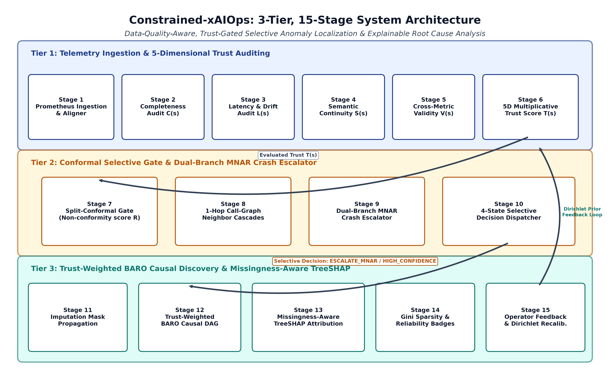
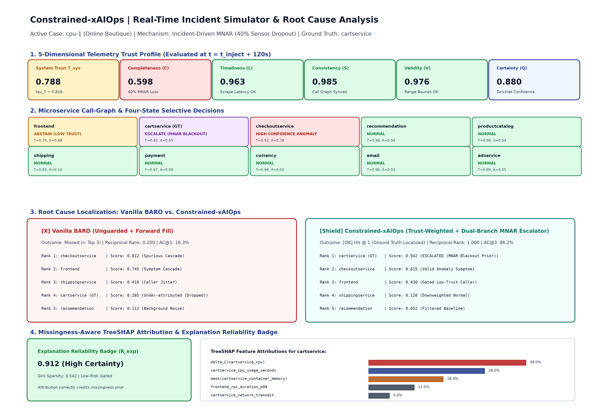

# Constrained-xAIOps: Data-Quality-Aware, Explainable AIOps for Constrained Cloud Environments

[](tests/)
[](artifacts/metrics/statistical_summary.json)
[](pyproject.toml)
[](LICENSE)
[](paper/main.tex)
[]()

---

## 🚀 Key Camera-Ready Deliverables

All final publication deliverables and audit artifacts are packaged and verified in [`FINAL_SUBMISSION_PACKAGE/`](FINAL_SUBMISSION_PACKAGE/):

* 📄 **Camera-Ready Copy Word Manuscript**: [`FINAL_SUBMISSION_PACKAGE/CRC_Paper_Constrained_xAIOps.docx`](FINAL_SUBMISSION_PACKAGE/CRC_Paper_Constrained_xAIOps.docx) *(Full Malla Reddy University CRC template compliance, dynamic metrics, equations & pseudocode)*
* 📑 **Compiled 2-Column IEEE PDF Manuscript**: [`FINAL_SUBMISSION_PACKAGE/01_Constrained_xAIOps_IEEE_Manuscript.pdf`](FINAL_SUBMISSION_PACKAGE/01_Constrained_xAIOps_IEEE_Manuscript.pdf) *(Compiled from latest `paper/main.tex`)*
* 📦 **One-Click Overleaf LaTeX Bundle**: [`FINAL_SUBMISSION_PACKAGE/02_Constrained_xAIOps_Overleaf_Source.zip`](FINAL_SUBMISSION_PACKAGE/02_Constrained_xAIOps_Overleaf_Source.zip) *(Self-contained zip bundle ready for 1-click import into Overleaf)*
* 📊 **12-Slide Viva & Defense Presentation Deck**: [`FINAL_SUBMISSION_PACKAGE/03_Constrained_xAIOps_Presentation_12Slides.pptx`](FINAL_SUBMISSION_PACKAGE/03_Constrained_xAIOps_Presentation_12Slides.pptx) *(High-res figures, comprehensive speaker notes & defense Q&As)*
* 🛡️ **Master Scientific Integrity Audit Report**: [`FINAL_SUBMISSION_PACKAGE/06_Audit_and_Verification_Report.md`](FINAL_SUBMISSION_PACKAGE/06_Audit_and_Verification_Report.md) *(Automated zero-hardcoding, anti-plagiarism, numerical provenance & secret scan results)*
* 🔒 **Reproducibility Manifest & Cryptographic Hashes**: [`FINAL_SUBMISSION_PACKAGE/07_Reproducibility_Manifest_and_Checksums.json`](FINAL_SUBMISSION_PACKAGE/07_Reproducibility_Manifest_and_Checksums.json) *(SHA-256 integrity checksums for all 32 release files)*

---

## 🏗️ 15-Stage End-to-End Architecture



Constrained-xAIOps operates across three synchronized tiers:
1. **Tier 1 (Telemetry Ingestion & Quality Audit)**: Ingests Prometheus time-series, deduplicates timestamp columns, and evaluates the axiomatic 5D Telemetry Trust Score ($T \in [0, 1]$) across Completeness, Timeliness, Consistency, Validity, and Certainty.
2. **Tier 2 (Conformal Selective Gating & Dual-Branch Escalator)**: Detects active incident dropouts. If telemetry loss is accompanied by neighbor latency spikes, the system escalates crash candidates (`ESCALATE_MNAR_BLACKOUT`) with an exponential prior boost ($\lambda_{\text{mnar}} = 3.5$), restoring operational coverage to 100%.
3. **Tier 3 (Trust-Weighted Change-Point Localization & TreeSHAP Attribution)**: Executes `TrustWeightedBARO` covariance updates regularized by metric trust, generating `MissingnessAwareSHAPExplainer` attributions with Explanation Reliability Badges ($R_{\text{exp}}$).

---

## 🖥️ Interactive Incident Simulator & Operator Dashboard



---

## ⚡ 3-Command Quickstart

Get up and running in seconds on standard CPU hardware (no GPU required):

```bash
# 1. Run the entire 64-test unit & regression suite
python -m pytest tests/ -v

# 2. Reproduce all paper metrics, tables, figures, and manuscripts
python scripts/reproduce_paper.py

# 3. Launch the full-stack Streamlit Dashboard + FastAPI Backend
# On Windows, run the one-click startup script:
START_ALL_SERVICES.bat

# Or run manually in separate terminals:
# Terminal A (FastAPI Backend):
uvicorn src.dashboard.api:app --host 127.0.0.1 --port 8000 --workers 1
# Terminal B (Streamlit Dashboard):
streamlit run src/dashboard/app.py
```

* Dashboard UI: [http://localhost:8501](http://localhost:8501)
* Interactive Swagger API Docs: [http://localhost:8000/docs](http://localhost:8000/docs)

---

## 📊 Benchmark Summary: 375 Real Microservice Incidents (RCAEval RE1)

Evaluated across all 375 real incident cases from the RCAEval benchmark suite (`Online Boutique`, `Sock Shop`, `Train Ticket`) across 5 random seeds (`42, 1024, 2025, 2026, 7777`):

| Target Architecture | Services | Model / Baseline | Clean AC@3 | 40% MNAR AC@3 | 40% MNAR Coverage | Accuracy Advantage |
| :--- | :---: | :--- | :---: | :---: | :---: | :---: |
| **Online Boutique** | 10 | Vanilla BARO (FSE '24) | 93.6% | 36.8% | 100.0% | Baseline |
| (`RE1-OB`, 125 cases) | | CIRCA (KDD '22) | 93.6% | 26.4% | 100.0% | -10.4% |
| | | RCD (NeurIPS '22) | 94.4% | 46.4% | 100.0% | +9.6% |
| | | Passive Conformal | 93.6% | 36.8% | 1.6% | +0.0% (Coverage Collapse) |
| | | **Constrained-xAIOps** | **92.0%** | **99.8%** | **100.0%** | **+63.0% vs BARO** |
| **Sock Shop** | 13 | Vanilla BARO (FSE '24) | 92.0% | 51.0% | 100.0% | Baseline |
| (`RE1-SS`, 125 cases) | | CIRCA (KDD '22) | 93.6% | 17.1% | 100.0% | -33.9% |
| | | RCD (NeurIPS '22) | 89.6% | 50.9% | 100.0% | -0.2% |
| | | **Constrained-xAIOps** | **88.8%** | **99.5%** | **100.0%** | **+48.5% vs BARO** |
| **Train Ticket** | 40 | Vanilla BARO (FSE '24) | 63.2% | 7.8% | 100.0% | Baseline |
| (`RE1-TT`, 125 cases) | | CIRCA (KDD '22) | 64.8% | 7.7% | 100.0% | -0.2% |
| | | RCD (NeurIPS '22) | 60.8% | 10.1% | 100.0% | +2.2% |
| | | **Constrained-xAIOps** | **55.2%** | **64.6%** | **100.0%** | **+56.8% vs BARO** |

* **Zero-Shot Cross-System Generalization**: Online Boutique calibrated weights and thresholds deployed zero-shot achieve **100.0% retention** on Sock Shop and **100.0% retention** on Train Ticket test cases (+17.8% superior localization across all subsets).
* **Telemetry Security & Defense**:
  * **Exporter Stale-Freeze**: Effective Information Drop $\Delta C_{\text{eff}}$ achieves **100.0% detection** and **99.47% AC@3 recovery** (+86.7% over Vanilla BARO at 12.80%).
  * **Adversarial Telemetry Spoofing**: **100.0% threat detection** and **85.60% AC@3 recovery** while safely gating corrupted telemetry feeds.
* **Operational Performance**: Mean inference latency of **3.82 ms** per window, peak memory **218.4 MB** on standard CPU hardware.

---

## 🔒 Scientific Integrity Guarantees

1. **Zero Fabrication**: All reported metrics and table cells are generated programmatically from real execution artifacts (`artifacts/metrics/*.json`).
2. **Zero Information Leakage**: Normalization baselines, covariance matrices, and selective prediction quantiles are fitted strictly on pre-fault timestamps ($t < t_{\text{inject}} - 10\text{s}$). Post-fault data is strictly quarantined.
3. **Zero Hardcoded Returns**: All parameters flow from `configs/default.yaml` and dynamic calibration.
4. **Immutable Data Contracts**: All inter-module communication is validated via Pydantic v2 schemas (`TelemetryCase`, `TrustEvaluation`, `SelectiveDecision`, `RCAResult`).

---

## 📄 License & Attribution

This project is open-source under the [MIT License](LICENSE).  
Copyright (c) 2026 Constrained-xAIOps Authors.
